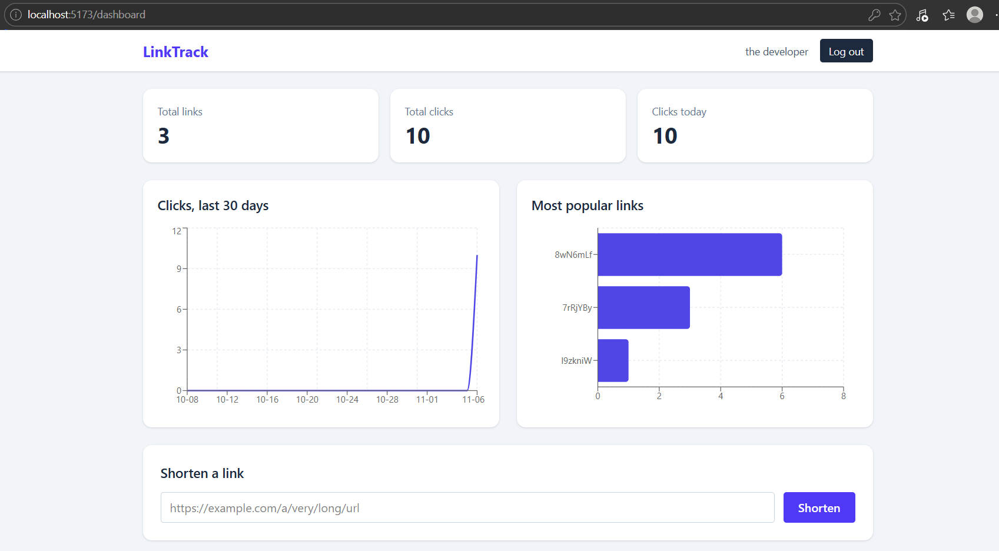
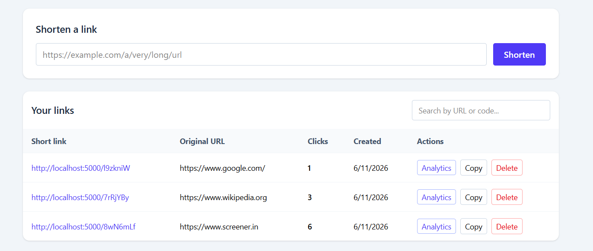

# LinkTrack – URL Shortener & Analytics Platform

A full-stack web app where registered users shorten long URLs, manage their links, and track clicks through an analytics dashboard.

## Features

- User registration and login (bcrypt password hashing, JWT authentication)
- Shorten URLs with unique 7-character codes (nanoid) and server-side URL validation
- Public short links that redirect with HTTP 302 and handle unknown or expired links
- Click tracking: every visit is stored as an event, with the referrer
- Dashboard: create, search, copy and delete links
- Analytics: total links and clicks, clicks today, 30-day click chart, most popular links, and per-link daily clicks and top referrers
- Ownership checks: users can only see and modify their own links

## Tech stack

| Layer | Technologies |
|---|---|
| Frontend | React (Vite), React Router, Tailwind CSS, Recharts |
| Backend | Node.js, Express, JWT, bcryptjs, nanoid, validator |
| Database | PostgreSQL (`pg` with connection pooling) |
| Testing | Postman |

## Screenshots






## Architecture

```text
React frontend  →  Express REST API  →  PostgreSQL
(client/)          (server/)            (users, urls, click_events)
```

When someone visits a short link, Express looks up the code, records a click event and increments the counter in a single database transaction, then redirects to the original URL. A tracking failure never blocks the redirect.

## Getting started

### Prerequisites

- Node.js 22 or newer (required by nanoid v6)
- PostgreSQL

### 1. Clone and create the database

```bash
git clone <your-repo-url>
cd <repo-folder>
```

Create a PostgreSQL database named `linktrack`, then run the schema:

```bash
psql -U postgres -d linktrack -f server/database/schema.sql
```

(Or paste `server/database/schema.sql` into pgAdmin's Query Tool.)

### 2. Start the backend

```bash
cd server
cp .env.example .env      # Windows PowerShell: Copy-Item .env.example .env
# edit .env: set DB_PASSWORD and a long random JWT_SECRET
npm install
npm run dev
```

The API runs on http://localhost:5000.

### 3. Start the frontend

In a second terminal:

```bash
cd client
npm install
npm run dev
```

Open http://localhost:5173.

## API reference

| Method | Endpoint | Auth | Description |
|---|---|---|---|
| POST | `/api/auth/register` | No | Register a user |
| POST | `/api/auth/login` | No | Log in, returns a JWT |
| POST | `/api/urls` | Yes | Create a short URL |
| GET | `/api/urls?search=` | Yes | List your URLs (optional search) |
| GET | `/api/urls/:id` | Yes | Get one URL |
| DELETE | `/api/urls/:id` | Yes | Delete a URL and its click events |
| GET | `/api/analytics/summary` | Yes | Dashboard statistics |
| GET | `/api/analytics/:id` | Yes | Analytics for one URL |
| GET | `/:shortCode` | No | Redirect (302) to the original URL |

Protected routes expect the header `Authorization: Bearer <token>`.

## Database schema

Three tables: `users`, `urls` (belongs to a user) and `click_events` (belongs to a URL). Foreign keys use `ON DELETE CASCADE`, and indexes cover `urls.user_id`, `click_events.url_id` and the unique `urls.short_code`. See `server/database/schema.sql`.

## Design decisions

- **Transactions** keep the click event and the click counter consistent.
- **A 404 for both "missing" and "not yours"** avoids revealing which link IDs exist.
- **Parameterised SQL queries** prevent SQL injection.
- **30-day charts use `generate_series`** so days with zero clicks still appear.
- **302 (temporary) redirects** stop browsers from caching the redirect and skipping click tracking.

## Possible improvements

Custom aliases, link expiration in the UI, QR codes, CSV export, rate limiting, httpOnly-cookie authentication.

## Author

<Your name> – <LinkedIn or GitHub link>